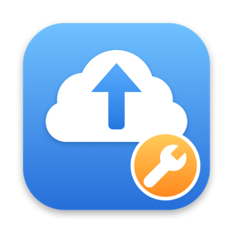

# OneDrive Free Up Fixer



Adds **Repair & Free Up Unpinned Files** to Finder's right-click menu for OneDrive files and folders
on macOS. It frees files that OneDrive's own "Free Up Space" can't, or that
re-download right after being freed.

## ⚠️ Read this first

**Use at your own risk.** This is an unofficial tool, not affiliated with, endorsed by or
supported by Microsoft or Apple. It edits private, undocumented databases of macOS's File
Provider and of OneDrive, and evicts the local copies of files. It was tested on one Mac with
the versions listed under [Proven on](#proven-on). Any OneDrive or macOS update can change how
these databases work. There is no guarantee that it won't break your OneDrive sync or lose
data.

**Before you use it:**

- **Make sure the files are fully uploaded and up to date in OneDrive.** The OneDrive menu bar
  icon should show no pending uploads or sync errors, and the files should show as synced in
  Finder. Freeing a file removes its local copy, so the copy in OneDrive is then the only one.
  The app also refuses to free any file that macOS doesn't report as fully uploaded, but don't
  rely on that alone.
- **Have a backup** of anything you can't afford to lose (for example Time Machine, or another
  copy outside OneDrive).
- **Try it on one expendable file first**, especially after any OneDrive or macOS update.
- **Understand Full Disk Access.** The app needs it to edit the File Provider database. Only
  grant it if you've read the code or trust it.

The app backs up OneDrive's databases before each run and logs every change (see
[Rollback](#rollback)). Those backups don't cover your files.

## The problem

With OneDrive on Apple's File Provider (`~/Library/CloudStorage/OneDrive-*`), files can stay
downloaded no matter how often you use OneDrive's "Free Up Space", or download again right
after being freed. "Always Keep on This Device" shows as off.

**Root cause (confirmed):**

1. "Always Keep on This Device" sets OneDrive's `capabilities` for the file to **47**, in
   `OneDrive.dat`, table `dbfs_files`. Read as macOS item capabilities, that value has no
   "allows evicting".
2. Unpinning, or OneDrive's own Free Up Space, does **not** reset it to the default **-1**.
3. With 47 still set, OneDrive's Free Up Space tells macOS `keepDownloaded`. macOS's File
   Provider then sets the file's content policy to 3 ("download and keep downloaded") and
   downloads the file, or refuses to evict it.

Each file has records in three places:

| Where | Field | Normal | Stuck |
|---|---|---|---|
| macOS `fileproviderd` database, table `FP_snapshot` | `decoration_content_policy` | 1 | **3** |
| OneDrive `OneDrive.dat`, table `dbfs_files` | `capabilities` | -1 | **47** |
| OneDrive `SyncEngineDatabase.db`, table `od_ClientFile_Records` | `lastKnownPinState` | empty / 0 | 2 after Free Up, 1 while pinned |

Check a file:

```sh
fileproviderctl evaluate "<file>" | grep -E "isKeepDownloaded|Content Policy"
# stuck: isKeepDownloaded = 0, Content Policy: 3, Inherited Content Policy: 1
```

## What the app does

**Quit OneDrive first.** The action refuses to run
while OneDrive is running and says so in a notification. It never starts OneDrive itself, so
you can repair several folders in a row and start OneDrive when you're done.

Stopping OneDrive from inside a run while it was downloading made it look like it crashed.
A clean quit by you avoids that.

For the selected files and folders it:

1. Checks that the selection is inside OneDrive, that the app has Full Disk Access, and
   that OneDrive isn't running. It also compares the OneDrive/macOS versions with the proven
   ones, and asks before continuing if they differ.
2. Leaves **intentionally pinned files** alone. Those are files set to "Always Keep on This
   Device", directly or through a pinned folder (OneDrive's pinned bit in `state_flags`).
   Freeing them without a real unpin would leave OneDrive believing they're pinned. To free
   them, turn off "Always Keep on This Device" in OneDrive first. Skipped files are listed
   in the log and counted in the notification.
3. Stops OneDrive's File Provider helper (macOS may relaunch it after you quit OneDrive) and
   backs up OneDrive's two databases to
   `~/Library/Application Support/OneDriveFreeUpFixer/backups/` (newest 5 kept).
4. Sets macOS policy 3 → 1 for every unpinned file in the selection, downloaded or
   cloud-only (`Resources/fp_set_policy.py`, only rows actually at 3). If anything changed,
   it restarts `fileproviderd` and waits 30 s.
5. Evicts the downloaded files with `FileManager.evictUbiquitousItem`, not OneDrive's
   action, but **only files macOS reports as fully uploaded** (`decoration_is_uploaded`).
   Any other file stays on disk, is listed in the log as `skipped: not fully uploaded`, and is
   counted in the notification. Finder's `.DS_Store` files are skipped.
6. Repairs OneDrive's records for those files: pin state 2/empty → 0, "freed" flag off, and
   `capabilities` 47 → -1 (left over from "Always Keep on This Device"), with integrity
   checks.
7. Records the final state and reports, in the notification, any file that's still on
   disk, at policy 3, marked by OneDrive or with pin capabilities.

If nothing in the selection is downloaded but records need repair (macOS policy 3, or
OneDrive pin state empty/2, its mark or capabilities 47), it runs the same steps without
evicting. It only stops early when every unpinned file is cloud-only with clean records.

Every run writes a detailed log, `~/Library/Logs/OneDriveFreeUpFixer/run-<date-time>.tsv`:

- one line per file per stage: `before`, `after-macos-fix`, `after-evict`,
  `after-onedrive-fix`, `final`;
- each line has the location (on disk or cloud-only), bytes on disk, macOS policy, macOS
  "fully uploaded" state, OneDrive pin state, OneDrive flags and OneDrive capabilities;
- timestamped `event` lines record every step: skipped pinned and not-uploaded files,
  helper stopped, backup
  path, the `fileproviderd` restart, evict failures, record changes and integrity checks,
  the item IDs for rollback;
- at the end, a `problem:` line for every unpinned file that's still on disk, at policy 3,
  marked or with pin capabilities.

The events and a per-stage summary also go to `~/Library/Logs/OneDriveFreeUpFixer.log`.

A run takes about 30 s plus the time to free the files.

## Proven on

| Component | Version |
|---|---|
| OneDrive | 26.168.0830 (build 26168.0830.0006) |
| macOS | 26.6.2 (25G83) |
| File Provider | 4018.160.6 |

This edits a private Apple database, so a OneDrive or macOS update can change the
behaviour. On other versions the app asks before running. Test on one expendable file,
then update `provenOneDrive` / `provenMacOSBuild` in `Sources/main.swift`.

## Install

Requires the Xcode Command Line Tools (`swiftc`, `python3`).

```sh
./scripts/install.sh
```

This builds the app, installs it to `~/Applications`, registers the Finder service and
shows the app in Finder. Then give it Full Disk Access, which it needs to edit the File
Provider database:

1. Open **System Settings → Privacy & Security → Full Disk Access**.
2. Drag **OneDrive Free Up Fixer** from the Finder window into the list, or click **+**,
   press Cmd+Shift+G, enter `~/Applications` and pick the app.
3. Make sure its switch is on.

- macOS has no permission prompt for Full Disk Access, so the app can't ask for it. It
  checks before doing anything, and if access is missing it explains and opens the
  settings page for you.
- The build is ad-hoc signed, so each re-install changes its signature. Remove the old
  entry (**−**) and add the app again, because toggling the switch isn't enough.
- If the menu item doesn't appear, enable it under **System Settings → Keyboard →
  Keyboard Shortcuts → Services → Files and Folders**.

Uninstall with `./scripts/uninstall.sh`.

## Rollback

**macOS records:** take the item IDs for a run from the log. Then, in a terminal with
Full Disk Access:

```sh
python3 -I Resources/fp_set_policy.py --from 1 --to 3 auto <ids...>; killall fileproviderd
```

**OneDrive records:** quit OneDrive, copy the files from the run's backup folder
(`~/Library/Application Support/OneDriveFreeUpFixer/backups/<timestamp>/`) back to their
places, then start OneDrive:

- `OneDrive.dat*` → `~/Library/Group Containers/UBF8T346G9.OneDriveSyncClientSuite/OneDrive.noindex/`
- `SyncEngineDatabase.db*` → `~/Library/Containers/com.microsoft.OneDrive-mac/Data/Library/Application Support/OneDrive/settings/Personal/`

## Don't

- Toggle "Always Keep on This Device" on stuck files: it re-downloads them.
- Rely on OneDrive's own "Free Up Space" for files that were ever pinned, until Repair &
  Free Up Unpinned Files has repaired them. After that, OneDrive's own Free Up Space works on them,
  until they're pinned again.
- Expect it to free pinned files: they're skipped on purpose (see above).
- Reset or unlink OneDrive to "fix" this: it drops every locally kept file.

## What we know (2026-10-14)

Found on 2026-10-14 on the versions above. Most of it comes from the macOS system log, which
records every policy OneDrive sends and why macOS downloads a file.

**The evidence.** OneDrive's item updates carry the policy:
`FP snapshot mutation: update<s:<id> … cp:keepDownloaded …> diffs:…contentPolicy why:item changed`,
then `fetch-content(<id>) why:materialization|itemChangedRemotely|backgroundWork`.

| Case | `capabilities` | What OneDrive sent on its own Free Up Space |
|---|---|---|
| 229 / 243 files (one folder, two tries) | 47 | `keepDownloaded`, and downloads started |
| 58, 44 and 11 files (three folders) | -1 | `lazy` |
| The same 287 files after the app reset 47 → -1 | -1 | `lazy` for all 294 updates, 0 downloads |

**Single-file reproduction:**

1. "Always Keep" on a file: pin state 1, caps 47, `keepDownloaded`.
2. OneDrive's Free Up Space: pin state 2, caps still 47, `keepDownloaded` again. It stays
   on disk.
3. Repair & Free Up Unpinned Files: caps -1, freed.
4. OneDrive's Free Up Space: `lazy`, nothing downloads.

**Ruled out:**

- **Pin state:** files at pin state 0 still got `keepDownloaded` while caps was 47.
  OneDrive also resets pin state to empty on its own.
- **OneDrive's "freed" flag** (`state_flags` bit 8).
- `in_materialized_set`.
- **Download history:** it correlates, because only downloaded files were ever pinned,
  but it isn't the cause.

**Other findings:**

- **Cloud-only files at macOS policy 3 are time bombs.** They download on the next
  `fileproviderd` or OneDrive restart, or on OneDrive's own Free Up Space. The app fixes
  them for the whole selection.
- **While OneDrive is running, it marks freed files** (pin state 2, flag). With OneDrive
  stopped during eviction, it doesn't. With caps -1 the marks are harmless.
- **Stopping OneDrive while files are downloading can fail.** macOS relaunches OneDrive's
  File Provider helper to finish the queue. That's what makes a run report "couldn't stop
  OneDrive", and OneDrive may look like it crashed.

**Find leftover pin capabilities** (read-only, works without Full Disk Access). This lists
files at caps 47 that aren't pinned now, per folder. Intentional pins are recognised by the
"pinned" bit in `state_flags` (`& 4`); files pinned through a parent folder have that bit
but an empty pin state.

```sh
OD="$HOME/Library/Group Containers/UBF8T346G9.OneDriveSyncClientSuite/OneDrive.noindex/OneDrive.dat"
SE="$HOME/Library/Containers/com.microsoft.OneDrive-mac/Data/Library/Application Support/OneDrive/settings/Personal/SyncEngineDatabase.db"
sqlite3 "file:$SE?mode=ro" "ATTACH 'file:$OD?mode=ro' AS fp; SELECT p.name, count(*) FROM fp.dbfs_files x JOIN fp.dbfs_files p ON p.itemid = x.parentid LEFT JOIN od_ClientFile_Records f ON f.itemIndex = x.fsid WHERE x.filetype = 0 AND x.tombstoned = 0 AND x.capabilities = 47 AND (x.state_flags & 4) = 0 AND coalesce(f.lastKnownPinState, -1) != 1 GROUP BY x.parentid ORDER BY 2 DESC;"
```

**See what OneDrive told macOS** (read-only; use `/usr/bin/log`, because in zsh `log` is a
built-in):

```sh
/usr/bin/log show --style compact --last 10m --predicate 'process == "fileproviderd"' > /tmp/fp_log.txt
grep "FP snapshot mutation: update" /tmp/fp_log.txt | grep -o 'cp:[a-zA-Z]*' | sort | uniq -c
grep "persist job: <FP.*fetch-content(" /tmp/fp_log.txt
```

## Icon

Drawn in code by `scripts/make_icon.swift`; regenerate `Resources/AppIcon.icns` with
`./scripts/make_icon.sh`.

## License

MIT
